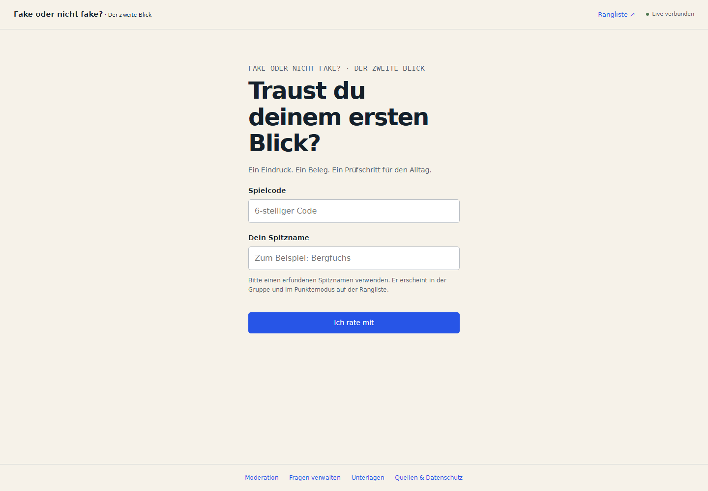

# Fake oder nicht fake?

**Der zweite Blick · Traust du deinem ersten Blick?** Eine moderierte Medienkompetenz-Challenge für Stand 02 am Digimärt Alpnach, 4. November 2026. Handy, Moderation und Beamer führen vom eigenen Eindruck über eine konkrete Quelle zum Urteil und einem Prüfschritt für den Alltag. Das Upgrade ergänzt zwölf Lernfälle und ein aus SQLite erzeugtes Drucksystem. Das bestehende Quiz mit acht Beispielen und Rangliste bleibt separat verfügbar.

Die neue Gestaltung nutzt Papier, dunkle Schrift, Kobaltblau und wenige Signalflächen. Fotos und Texte stehen im Zentrum. Animationen sind kurz; die Betriebssystem-Einstellung für reduzierte Bewegung wird berücksichtigt.

**Stack:** Node.js 24 LTS, Express 5, Socket.IO 4, SQLite (`node:sqlite`), Vanilla JavaScript. Kein Build-Schritt, keine laufenden KI-API-Kosten, keine externen Laufzeit-CDNs. Alle Beispielbilder und der QR-Generator sind enthalten.

## Schnell starten

Node.js **24.14 oder neuer innerhalb der 24er-LTS-Reihe** installieren. Die eingebaute SQLite-Schnittstelle ist in dieser Version noch als experimentell markiert; Node kann beim Start einen entsprechenden Hinweis ausgeben.

```powershell
git clone https://github.com/Witzelfitz/fake-oder-nicht-fake.git
cd fake-oder-nicht-fake
npm ci
npm start
```

1. `http://localhost:3000/host` öffnen.
2. Beim Upgrade zuerst unter `/admin` anmelden und **Lernpaket importieren** öffnen. Die Vorschau zeigt neue, unveränderte und lokal abweichende IDs. Nur neue IDs werden ergänzt. Ohne Import bleibt der bisherige Quizmodus verfügbar.
3. Unter `/host` Modus und Fallset wählen; Moderationsschlüssel aus dem Server-Terminal eingeben.
4. Bei **Adresse für die Handys** die erreichbare WLAN-/LAN-Adresse des Laptops auswählen, z. B. `http://192.168.1.42:3000`.
5. Spielraum erstellen und **Beamer öffnen** anklicken. Dort stehen QR-Code und sechsstelliger Spielcode.
6. Handys mit demselben Netz verbinden, QR scannen, Spitznamen wählen.
7. Challenge starten, abstimmen, auflösen, kurz diskutieren und weiterschalten.

Die Erstinstallation braucht Internet. Danach funktioniert der Betrieb im lokalen Netz ohne Internet. Externe Quellenlinks benötigen Internet, die eingebauten Auflösungen nicht. Gäste-WLANs mit Client-Isolation verhindern möglicherweise den Zugriff auf den Laptop. Die lokale Windows-Firewall muss eingehende Verbindungen zum gewählten Node-Port erlauben; vor dem Anlass mit einem zweiten Gerät testen.

## Ansichten

| Pfad | Zweck |
| --- | --- |
| `/` | Beitreten mit Spielcode und Spitzname; danach persönliche Abstimmung |
| `/host` | Geschützte Moderation, neue Gruppe, Start, Auflösung, nächste Frage |
| `/admin` | Geschützte Fragenverwaltung mit Bild-Upload, Texteingabe und Reihenfolge |
| `/screen?code=123456` | Beameransicht ohne Steuerrechte |
| `/leaderboard` | Gespeicherte Stand-Rangliste; aktualisiert sich alle zehn Sekunden |
| `/materials` (auch `/stand.html`) | Geschützte Publikationssnapshots, Druckansichten und Anlassprofile |
| `/merkkarte.html` | Öffentliche druckbare Methodenkarte ohne Falllösungen |
| `/sources.html` | Bildnachweise, Lizenzen, Herkunftserklärungen und Speicherhinweise |

Die Moderation ist pro Raum über einen zufälligen Zugang geschützt. Der Host-Zugang bleibt im Session Storage dieses Browser-Tabs. Den Tab bis zum Ende geöffnet lassen. Nach einem Neuladen verbindet er sich wieder. Der globale Moderationsschlüssel wird bei jedem Start neu erzeugt, sofern `HOST_KEY` nicht gesetzt ist.



[Quizansicht](docs/quiz-desktop.png) · [Handyansicht](docs/quiz-mobile.png) · [Fragenverwaltung](docs/admin-desktop.png)

## Modi und Fallsets

| Modus | Ablauf und Wertung |
| --- | --- |
| `learning-v1` · Stand-Challenge | Eigener Tipp → Verteilung → Beleg → Urteil → Transfer; drei Antwortmöglichkeiten und optionale Sicherheit. Keine Punkte und keine globale Rangliste. |
| `workshop-v1` · Quellenwerkstatt | Ersturteil → lokale Quellenkarten → Zweiturteil → moderierte Auflösung. Beide Antworten bleiben getrennt gespeichert. |
| `speed-streak-v2` · bisheriges Quiz | Zwei Herkunftsoptionen, Tempo- und Serienpunkte, kompatible Rangliste. Regeln unten. |

Im Lernmodus schliesst Zeitablauf nur die Eingabe. Die Moderation bestimmt, wann Quellen und Auflösung erscheinen, und kann einen Fall überspringen. Die Abschlussansicht zeigt tatsächlich bearbeitete Fälle und eigene Erst-/Zweiturteile, keinen Kompetenzwert. Die vier Auflösungsschritte bleiben beim Neuladen und Serverneustart erhalten. Parallel eingehende Antworten setzen Fokus, Bildzoom und Sicherheitseingabe nicht zurück.

Zwölf freigegebene Fälle liegen in `content/case-pack.json`: `stand-6` (sechs Fälle, etwa 8–12 Minuten), `werkstatt-4` (vier Fälle, 45 Minuten), `alltag-6` (Alltagsbehauptungen und Kontext) und `bibliothek-12`. Zielgruppen-Voreinstellungen wählen Sek I → Stand, Sek II → Quellenwerkstatt, Eltern/Fachpersonen → Alltag; Modus und Set sind danach weiter anpassbar. Das ist eine redaktionelle Voreinstellung, keine validierte Alterseinstufung. Eine kontrollierte Kreativaufgabe ergänzt die Werkstatt auf 90 Minuten.

CLI-Import, ebenfalls ohne Überschreiben eigener Fassungen:

```powershell
npm run content:import
npm run content:import -- --apply
```

Der erste Befehl ist nur Vorschau. Beide beachten `DB_PATH` aus `.env`. Keine automatische Wiederbefüllung einer geleerten Bibliothek.

## Regeln des Punktemodus

- Pro Gruppe ein neuer Raum, bis zu 100 Beitritte; ab dem Quizstart sind neue Beitritte gesperrt. Bereits angemeldete Geräte können sich wieder verbinden.
- Antwortzeit wählbar: 15, 20, 25, 30, 45 oder 60 Sekunden.
- Ein Tipp pro Frage; nur der Server entscheidet über Frist und Punkte. Antworten sind nach der Auswahl unveränderbar.
- Richtiger Tipp: **1’000 Basispunkte + bis zu 500 Tempopunkte + bis zu 400 Serienpunkte**. Falsch oder nicht abgestimmt: 0 Punkte und Unterbrechung der Trefferfolge.
- Zeitablauf öffnet automatisch die Auflösung. Die Moderation darf früher auflösen und schaltet danach selbst weiter.
- Antworten, Punkte und Spielphase werden in SQLite gespeichert. Auch ein Server-Neustart erhält die Runde; eine inzwischen abgelaufene Frage wird aufgelöst.
- Die Stand-Rangliste zählt nur beendete Runden, in denen die Person alle Fragen beantwortet hat. Sie vergleicht dasselbe Fragenset, dieselbe Antwortzeit und dieselbe Wertungsversion. In der separaten Ranglistenansicht lässt sich die Antwortzeit auswählen. Unvollständige Teilnahmen bleiben in der Gruppenrangliste sichtbar.
- Nach dem Ergebnis mit **Neue Gruppe** einen neuen Raum erstellen. Alte Ergebnisse bleiben erhalten.

### Tempo, Serie und Rang

Der Zeitbonus fällt linear von 500 auf 0 Punkte über die gesamte Antwortzeit: `round(500 × (1 − Antwortzeit / Zeitlimit))`. Die Antwortzeit misst der Server ab Fragenstart bis zum Eingang der Antwort; vom Handy übermittelte Zeiten oder Punkte werden ignoriert. Netzwerk- und Ladezeiten sind darin enthalten.

Ab dem zweiten richtigen Tipp in Folge gibt es 100 Serienpunkte, ab dem dritten 200, ab dem vierten 300 und ab dem fünften jeweils 400. Eine falsche oder ausgelassene Frage setzt die Folge zurück. Maximal sind 1’900 Punkte pro Frage möglich.

Beispiel bei 20 Sekunden Zeitlimit: Ein richtiger Tipp nach 5 Sekunden mit einer vorherigen Zweier-Serie ergibt `1’000 + 375 + 200 = 1’575` Punkte.

Sortiert wird nach Gesamtpunkten, dann richtigen Antworten und danach durchschnittlicher Zeit der richtigen Antworten (auf Millisekunden gerundet). Identische Werte teilen sich den Rang. Die Tabelle zeigt Treffer, Durchschnittszeit und längste Serie; in der Gruppe zusätzlich die Rangänderung zur vorherigen Auflösung. Die persönliche Auflösung zeigt die genaue Punkteaufteilung.

Bestehende Datenbanken werden beim Start automatisch migriert. Vorhandene Räume behalten die frühere 1’000-Punkte-Wertung und werden nicht mit neuen Ergebnissen vermischt.

## Didaktischer Rahmen

Die Antwortmöglichkeiten heissen **«Mit KI erzeugt»** und **«Ohne generative KI»**. «Fake» im Titel ist der Gesprächseinstieg. Das Quiz unterscheidet die Entstehung eines Beispiels von seinem Wahrheitsgehalt.

Vier Beispiele stammen aus dokumentierten menschlichen Quellen und vier wurden für das Quiz generiert. Das Fronalpstock-Panorama ist fotografiert und digital zusammengesetzt. Das historische Plakat ist gestaltet, nicht fotografisch realistisch. Der KI-Wolkentext ist sachlich zutreffend. Die historischen Texte sind bewusst ein leichter Einstieg und kein repräsentativer Blindtest moderner Alltagstexte.

**Kernbotschaft:** Quelle suchen, Kontext prüfen, zweite Quelle finden. Visuelle Fehler und Schreibstil sind Anhaltspunkte, aber kein sicherer KI-Nachweis. Das Quiz ist keine Erkennungssoftware und keine belastbare Messung der individuellen Medienkompetenz. Wiederholungen derselben Beispiele beeinflussen die Rangliste.

## Standunterlagen und PDF-Export

Die tatsächlich gerenderten Dateisätze liegen unter [docs/materials](docs/materials/README.md). Teilnehmermaterial und Moderationslösungen liegen in separaten Ordnern; die Kontaktbögen enthalten auch Lösungen und gehören zur Moderation.

- Stand: acht PDFs / 24 Seiten, darunter Plakate A4/A3, Guide (4), Arbeitsblatt (2), Fallblätter (6), Lösungen (6), A6-Merkkarte und Quellenverzeichnis (3).
- Werkstatt: sieben PDFs / 21 Seiten, darunter Guide (4), Werkstattheft (4), Quellenstationen (4), Lösungen (4), Quellenverzeichnis (2), anonyme Reflexion und Kreativauftrag (2).
- [Standplakat A4](docs/materials/stand-6/teilnehmende/standplakat-a4.pdf) · [Fallblätter](docs/materials/stand-6/teilnehmende/fallblaetter.pdf) · [Moderationsguide](docs/materials/stand-6/moderation/moderationsguide.pdf) · [Werkstattheft](docs/materials/werkstatt-4/teilnehmende/werkstattheft.pdf).

`/materials` erstellt mit Moderationsschlüssel einen unveränderlichen Publikationssnapshot aus der **aktiven SQLite-Bibliothek** oder einem gewählten Lernraum. Bearbeitungen danach ändern diesen Export nicht. Druckansichten werden über einmalige, fünf Minuten gültige Lesetickets geöffnet; der Admin-Schlüssel steht nie in der Druck-URL. Im Browser Browser-Kopf-/Fusszeilen deaktivieren. Eine gespeicherte PDF-Datei ist danach ein normales weitergebbares Dokument.

Allgemeine Plakate enthalten bewusst **keinen QR**, sondern «QR und Spielcode am Beamer». Ein Raumplakat setzt eine bestehende Lobby mit offenem Beitritt, eine erreichbare Adresse und die bestätigte Prüfung auf einem zweiten Gerät voraus. Keine localhost-QRs und keine erfundene dauerhafte Adresse. Eine stabile HTTPS-Startadresse lässt sich unter Anlass & Ressourcen konfigurieren, sobald sie tatsächlich eingerichtet ist. Bereits erstellte Raumplakate verfallen praktisch, sobald der Beitritt geschlossen ist.

Für einen reproduzierbaren lokalen PDF-Build (zusätzliche Entwicklungswerkzeuge, nicht für den laufenden Quizserver nötig):

```powershell
npm ci
npx playwright install chromium
python -m venv .venv
.venv/Scripts/python.exe -m pip install -r requirements-pdf.txt
$env:PDF_PYTHON=(Resolve-Path .venv/Scripts/python.exe).Path
npm run publication:snapshot -- --set stand-6 --out output/publication.json
npm run pdf:build -- --snapshot output/publication.json --out publications/mein-stand
```

Werkstatt: beim Snapshot `--set werkstatt-4 --mode workshop-v1` verwenden. Ein bestimmter Raum wird mit `--room SECHSSTELLIGER_CODE` exportiert. Alternativ die Snapshot-JSON aus `/materials` herunterladen. Die JSON enthält Lösungen/private Moderationsnotizen und gehört geschützt aufbewahrt. Exportordner immer pro Publikation wählen; die QA-Previews dieses Ordners werden beim erneuten Build ersetzt.

Der Build wartet auf lokale Schriften und Bilder, sperrt externe Netzabrufe, erstellt PDFs und zugängliche HTML-Fassungen mit lokalen Assets. Danach prüft Python Formate, eingebettete Schriften, Textgrenzen, Mindestgrössen und Bildauflösung und rendert **jede Seite bei 150 dpi**. Der Manifestbericht enthält Fall-IDs/Revisionen, Snapshot, Renderer und SHA-256 je PDF. QR-Prüfung dekodiert den Code aus dem finalen PDF-Rendering. `npm run pdf:check -- --dir publications/mein-stand` prüft erneut; danach bleibt die visuelle Freigabe ausdrücklich offen, bis die neuen Renderings angesehen wurden. Ein neuer Build braucht immer eine neue Sichtprüfung.

Verwendete PDF-Schriften: DejaVu Sans und DejaVu Sans Mono, lokal eingebettet; Haupttext mindestens 10.5 pt, Quellen/Metadaten mindestens 9 pt. A6 ist eine echte Einzelkarte, kein A4-Kartenbogen. PDFs sind kopierbar und getaggt, aber **nicht als PDF/UA oder PDF/X zertifiziert**. Physischer Druck, Beamer aus Raumdistanz und WLAN mit echten Handys sind vor Ort noch zu prüfen. Herkunfts-/Lizenzangaben auf gedruckten Fällen können Hinweise auf das Urteil geben; sie sind kein Blindtest.

## Konfiguration

Optional `.env.example` nach `.env` kopieren. `.env`, Datenbanken, Protokolle und Testergebnisse sind von Git ausgeschlossen.

| Variable | Standard | Zweck |
| --- | --- | --- |
| `PORT` | `3000` | HTTP- und Socket.IO-Port |
| `HOST` | `0.0.0.0` | Netzwerkschnittstelle; `127.0.0.1` für nur lokalen Zugriff |
| `HOST_KEY` | zufällig beim Start | Schlüssel zum Erstellen neuer Spielräume |
| `DB_PATH` | `./data/quiz.sqlite` | Persistente SQLite-Datei |
| `PUBLIC_URL` | Adressauswahl in Moderation | Erreichbare HTTP(S)-Basisadresse für QR und Beitritt |

Öffentliches Hosting: ein Node-Prozess mit beschreibbarem dauerhaftem Datenträger, HTTPS und Reverse Proxy mit WebSocket-Unterstützung. Bei Docker Port 3000 veröffentlichen und `data/` als Volume einbinden. Dieser MVP unterstützt **eine Serverinstanz**; SQLite und Raum-Timer sind nicht für horizontale Replikation ausgelegt. Auf rein statischem Hosting oder GitHub Pages laufen weder Socket.IO noch SQLite. Ein GitHub-Upload ist noch kein Live-Deployment.

Für Coolify: [Einrichtung, persistente Daten und erster Start](docs/COOLIFY.md). Das Dockerfile enthält einen Healthcheck mit Node.js, ohne zusätzliche curl-/wget-Abhängigkeit.

```sh
docker build -t fake-quiz .
docker run --rm -p 3000:3000 --env-file .env -v fake-quiz-data:/app/data fake-quiz
```

## Eigene Fragen im Backend

1. `/admin` öffnen und mit dem **Moderationsschlüssel aus dem Terminal** anmelden.
2. **Neue Frage** wählen. Lernfälle sind standardmässig aktiviert: Entstehung, Behauptung oder Kontext als Prüfachse wählen, eine Leitfrage und das Urteil nach Quellenprüfung festlegen. Für den bisherigen Punktemodus die Lernfall-Option ausschalten.
3. Foto/Plakat als **PNG, JPEG oder WebP bis 12 MB** hochladen oder einen Text einfügen.
4. Eine Erklärung zur Auflösung eintragen. Merksatz, Quellenlink, Urheber und Nutzungsangaben lassen sich ergänzen.
5. Lernfälle zuerst als **Entwurf** speichern. Quellenkarten mit Originaladresse (falls vorhanden), Fundstelle, Datum, Aussagegrenze und Rechten ergänzen; Grenze und Transferfrage eintragen. Erst nach expliziter Quellen-, Rechte- und didaktischer Prüfung mit Datum/Prüfer:in auf **Freigegeben** setzen. Inhaltsänderungen im Editor setzen die Freigabe zur erneuten Prüfung zurück.
6. **In neuen Runden verwenden** wählen und speichern. Über die Pfeile in der Liste die Reihenfolge anpassen.

Bestehende Fragen können bearbeitet, deaktiviert und gelöscht werden. Löschen verlangt eine zweite Bestätigung. Gleichzeitige Änderungen an einer Frage werden erkannt, statt gespeicherte Fassungen still zu überschreiben. Ein Neustart nach Änderungen ist nicht nötig; die aktuelle aktive Bibliothek wird beim Erstellen einer neuen Runde übernommen. Mindestens eine aktive Frage ist erforderlich.

Beim ersten Start wird die Bibliothek einmalig aus `content/questions.json` in SQLite übernommen. Danach ist die **SQLite-Bibliothek** massgeblich; Änderungen an der Seed-Datei überschreiben eigene Inhalte nicht. Nach dem Löschen aller Fragen wird die Bibliothek beim Neustart nicht erneut befüllt.

Eigene Fragen liegen in derselben SQLite-Datei wie die Ergebnisse. Uploads liegen in `uploads/` neben der Datenbank, standardmässig also `data/uploads/`. Für ein Backup den Server stoppen und Datenbank **und** Upload-Ordner zusammen sichern. Eigene Materialien werden durch `.gitignore` vom GitHub-Upload ausgeschlossen. Beim Docker-Betrieb beide über das `data/`-Volume sichern.

Jeder Raum erhält einen unveränderlichen Schnappschuss seines Fragensets. Bearbeiten oder Löschen einer Frage verändert laufende Räume nicht. Deshalb bleiben auch nicht mehr verwendete Upload-Dateien auf der Festplatte erhalten; eine automatische Medienbereinigung ist nicht eingebaut. Ein geändertes Fragenset erhält eine neue Kennung für die Stand-Rangliste.

Der Admin-Schlüssel wird für diesen Browser-Tab im Session Storage gespeichert. Abmelden entfernt ihn dort. Schreibzugriffe und Bildvorschauen sind serverseitig geschützt. Vor der Auflösung überträgt der Spielserver weder Lösung, Erklärung noch Bonuswerte der aktuellen Antwort. Im Werkstattmodus erscheinen kuratierte Quellenkarten ab der Quellenphase; private Moderationsnotizen bleiben beim berechtigten Host. Feldfreigaben erfolgen über explizite Allowlists. Die Quellenansicht und ein zugängliches Repository können dennoch Hinweise geben; das ist kein prüfungssicheres System.

## Tests

```sh
npm run verify
npx playwright install chromium
npm run test:e2e
```

Alternativ mit vorhandenem Chrome unter PowerShell: `$env:PW_CHANNEL='chrome'; npm run test:e2e`.

Der Änderungs- und Prüfbericht steht unter [docs/UPGRADE_REPORT.md](docs/UPGRADE_REPORT.md). Zusätzlich: `npm run pdf:qr:test` prüft ein reales LAN-Lobbyplakat mit zwei getrennten Browser-Kontexten und dekodiert den QR aus dessen PDF; `npm run pdf:fixtures` prüft neun ausdrücklich synthetische QA-Fälle mit langen Texten und fehlendem Pflichtbild. Diese Testfälle sind keine publizierten Lerninhalte.

Die Tests prüfen Moderationsrechte, Antwortfristen, serverseitige Punkte, Tempo- und Serienboni, Rangfolgen, Wiederverbindung, Neustarts und die Migration vorhandener Daten. Die Fragenverwaltung wird inklusive Upload, Versionierung, Reihenfolge, Deaktivierung und Löschung getestet. Browser-Tests spielen acht Fragen mit Moderation, Beamer und zwei getrennten Handy-Kontexten und bearbeiten eigene Texte und Bilder im Backend. Eine GitHub-Actions-Vorlage unter `docs/github-actions-workflow.yml.example` führt die Tests unter Node 24 aus. Sie ist noch nicht aktiviert: Dem für den Upload verfügbaren GitHub-Zugang fehlt die `workflow`-Berechtigung.

## Daten löschen

Nur Spitznamen verwenden. Nach dem Anlass den Server beenden und **alle Räume, Antworten und Ranglisten** entfernen:

```sh
npm run db:reset -- --confirm
```

Ohne `--confirm` verweigert das Skript das Löschen. **Eigene Fragen und Uploads bleiben erhalten.** Browserdaten bei Bedarf separat löschen. Unter `/materials` lässt sich ausdrücklich eine Löschfrist von 1–365 Tagen aktivieren. Beim nächsten Serverstart werden ausschliesslich abgeschlossene Räume gelöscht, deren Erstellungszeit älter als diese Frist ist; offene Räume bleiben erhalten. Standard: keine automatische Löschung. Publikationssnapshots und lokale Exportdateien bleiben separat erhalten. Ein CSV-Export und eine Einzelpersonen-Löschoberfläche sind nicht eingebaut. Näheres unter `/sources.html`.

## Dateien und Rechte

Software: [MIT](LICENSE). Die fremden Bilddateien behalten ihre jeweiligen Rechte: [ASSETS.md](ASSETS.md). Vollständige Bildprompts und Prüfsummen: [content/provenance.json](content/provenance.json). Generierte Inhalte sind für das Quiz erstellt und ausdrücklich als solche dokumentiert.
